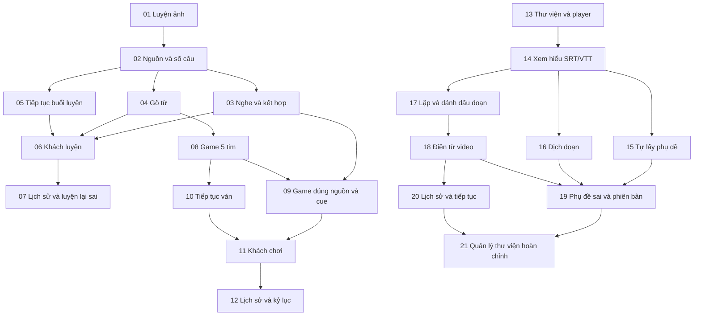

# Tracker — Luyện tự do, Game bắn cá, Học YouTube

Ngày xuất: 01/11/2026 (Asia/Saigon). Chủ sản phẩm đã duyệt sơ đồ và tracker Markdown local.

**Trạng thái:** 0 planned, 0 đang thực hiện, 21 hoàn tất, 0 blocked. **Execution authorized: yes — owner assigned 2026-11-01.**

Chủ sản phẩm đã giao thực thi 21 ticket trong chat ngày 2026-11-01. Story/technical contract phải đạt gate trước code. Phát hành là bước riêng.

[Spec thống nhất](../../docs/plans/practice-and-link-learning-2026-11-01/spec.md) · [Sơ đồ đã duyệt](../../docs/plans/practice-and-link-learning-2026-11-01/tickets-proposed.md) · [Index JSON](index.json)

## Cách nhận việc

- Thứ tự sản phẩm: Luyện tự do (01–07) → Game (08–12) → Video (13–21).
- Cạnh Blocked by chỉ điều kiện kỹ thuật; frontier kỹ thuật ban đầu 01/13, frontier đã giao theo index; vẫn chỉ một story đang triển khai.
- Ticket đề xuất làm đầu khi được giao: **01**. Không tự bắt đầu video hoặc nhiều story chỉ vì không có blocker.
- Một file là một ticket chuẩn. Khi thay trạng thái/body cần đồng bộ mục lục, index và hash tương ứng.
- ID 01–21 thuộc phạm vi tracker này, không phải ticket biên tập cùng số.
- Không gửi issue lên dịch vụ ngoài, không tự giao worker, gọi provider trả phí hoặc thay DB/cloud.

## Danh sách ticket

| ID | Ticket | Đợi | Trạng thái |
| --- | --- | --- | --- |
| 01 | [Hoàn thành một buổi luyện ảnh chọn từ cho tài khoản](issues/01-account-image-choice.md) | — | done |
| 02 | [Chọn nguồn và quy mô buổi luyện đúng phạm vi](issues/02-practice-scope-and-count.md) | 01 | done |
| 03 | [Luyện nghe và luân phiên ảnh/nghe với lựa chọn từ](issues/03-listening-and-mixed-practice.md) | 02 | done |
| 04 | [Gõ từ tiếng Anh trong buổi luyện đã chọn](issues/04-type-word-practice.md) | 02 | done |
| 05 | [Lưu và tiếp tục buổi luyện tài khoản trên cùng thiết bị](issues/05-resume-account-practice.md) | 02 | done |
| 06 | [Khách luyện đầy đủ với lịch sử và tiếp tục trên thiết bị](issues/06-guest-practice.md) | 03, 04, 05 | done |
| 07 | [Xem lịch sử, từ cần luyện thêm và luyện lại câu sai](issues/07-practice-history-and-retry.md) | 06 | done |
| 08 | [Chơi một ván bắn cá 5 tim bằng ảnh và gõ từ](issues/08-fish-game-five-hearts.md) | 04 | done |
| 09 | [Chơi liên tục đúng nguồn với ảnh/nghe/kết hợp](issues/09-game-scoped-continuous-play.md) | 03, 08 | done |
| 10 | [Tạm dừng, tiếp tục và bắt đầu ván mới đúng tim/điểm](issues/10-resume-game.md) | 08 | done |
| 11 | [Khách chơi và tiếp tục ván với dữ liệu cục bộ](issues/11-guest-game.md) | 09, 10 | done |
| 12 | [Lịch sử và kỷ lục game riêng theo nguồn/kiểu gợi ý](issues/12-game-history-and-records.md) | 11 | done |
| 13 | [Thêm video vào thư viện riêng và xem bằng player gốc](issues/13-private-youtube-library.md) | — | done |
| 14 | [Xem hiểu với phụ đề Anh nhập SRT/VTT theo thời gian video](issues/14-timed-subtitle-import.md) | 13 | done |
| 15 | [Tự lấy phụ đề Anh từ nguồn hỗ trợ trong quota đã xác minh](issues/15-provider-timed-transcripts.md) | 14 | done |
| 16 | [Dịch đoạn được chọn và xem phụ đề Anh–Việt có dùng lại](issues/16-segment-translation.md) | 14 | done |
| 17 | [Chọn/nghe lặp và đánh dấu đoạn khó trong video](issues/17-video-segment-replay-bookmarks.md) | 14 | done |
| 18 | [Luyện nghe điền từ trên đoạn video đã chọn](issues/18-video-gap-fill.md) | 17 | done |
| 19 | [Báo phụ đề sai và thay phiên bản mà giữ lịch sử đúng nguồn](issues/19-subtitle-errors-and-versions.md) | 15, 16, 18 | done |
| 20 | [Lịch sử luyện video và tiếp tục buổi dở cùng thiết bị](issues/20-video-history-and-resume.md) | 18 | done |
| 21 | [Quản lý/xóa dữ liệu video riêng và xử lý nguồn không còn phát được](issues/21-video-library-management.md) | 19, 20 | done |

## Sơ đồ phụ thuộc

## Các nhánh có thể tách khi được giao

- Sau 02: 03 / 04 / 05.
- Sau 08 và khi 03 đã xong: 09 / 10.
- Sau 14: 15 / 16 / 17. Thiếu quota provider không chặn đường nhập sub/lặp/điền từ, nhưng nhóm video chưa thể gọi hoàn tất.
- Sau 18 và khi 15/16 đã xong: 19 / 20.
- Trước làm song song cần thống nhất hợp đồng và người sở hữu migration/phần dùng chung; không tự mở nhiều story.

## Ràng buộc chung

- UI → API/luật có thẩm quyền → lưu/đọc lại → kiểm thử hành vi đi cùng lát cắt;
  trường hợp chỉ ảnh hưởng phía khách vẫn kiểm chứng qua UI và lưu cục bộ.
- Dữ liệu riêng kiểm tra auth/quyền sở hữu hiện hữu; không tin ID hoặc điểm/
  tim/đúng-sai do client tự nhận. Logout/đổi tài khoản không lộ dữ liệu trước đó.
- Luyện/game/video không thay ngày ôn, revision học chính, số từ đã học, XP,
  chuỗi hoặc từ yếu/lịch sử của Ôn theo lịch. Kiểm tra tác dụng phụ ở API khi có ghi.
- Không lộ đáp án qua nhãn/alt/trợ năng; mobile, bàn phím, focus và các trạng
  thái loading/error/empty/success thuộc tính năng, không dồn sang ticket cuối.
- Retry/save cần idempotency ngay khi bắt đầu ghi dữ liệu; không hoãn quyền
  truy cập/chống ghi trùng đến một ticket hardening sau cùng.
- Web/API là seam nghiệm thu đã duyệt; mock provider/player ở biên I/O, không
  mock từng helper. Provider live chỉ được xác minh trong quota đã kiểm tra,
  không gọi trả phí hoặc tuyên bố mock pass là tích hợp thật hoàn tất.
- Mỗi ticket cập nhật story/bằng chứng và các tài liệu bàn giao cần thiết. Không
  tự commit/push/deploy, chạy migration cloud hoặc tạo media mới từ đề xuất này.

## Phủ spec và bằng chứng

- 90 user stories: 1–85 được gắn trực tiếp; 86–90 là yêu cầu chung/thứ tự sản phẩm.
- Giữ đủ 95 acceptance criteria cụ thể đã duyệt; ràng buộc chung được đính kèm mỗi ticket.
- Index ghi hash nguồn spec/sơ đồ và hash/length từng ticket để đối chiếu bản đã xuất.
-15/16 đã xác minh Supadata native và DeepL EN→VI thật trong quota miễn phí; không suy ra tích hợp thật từ mock.
- Markdown là nguồn chuẩn; hash là đối chiếu phiên bản, không cấm cập nhật ticket có truy vết khi được giao.

## Kết quả triển khai hiện tại

**21/21 ticket done, không còn blocker hoặc story đang triển khai.** Supadata lấy phụ đề gốc và DeepL dịch Anh–Việt đã kiểm tra thật trong quota miễn phí; thư viện riêng, phụ đề, đoạn nghe lặp, điền từ, lịch sử và xóa dữ liệu theo phạm vi đã ghép hoàn chỉnh.

[Bằng chứng cuối](evidence/final-verification.md) · [Provider đã xác minh](evidence/provider-blockers.md) · [Checkpoint](CHECKPOINT.md) · [Cấu hình provider](../../docs/plans/practice-and-link-learning-2026-11-01/provider-setup.md).

120files/1417tests và143/143Chromium (gồm playerYouTube thật), lint/typecheck/build, SQL35 rollback và strictUIaudit0 PASS. Supadata còn99credits; DeepL còn999,967ký tự tại lần kiểm tra. Runtime kiểm quota trước xử lý; không fallback trả phí. Phần này ghi nhận nghiệm thu local ngày01/11; Production ngày02/11 được ghi bên dưới.

## Production —2026-11-02

All21features are live at https://vocab-flow-steel.vercel.app. Migrations0025–0035 applied, pending0. CoreCI/TrustedDBgreen, datahashes unchanged, actualprodAPI/guestpractice/game smokePASS. SameSHA Linuxbuild fixed WindowsartifactmissingHono afterrollback. [Release report](../../docs/releases/practice-game-video-2026-11-02.md). ExistingGitHubdeploytoken stillneeds separatecredentialauthorization; currentProduction release is complete.
