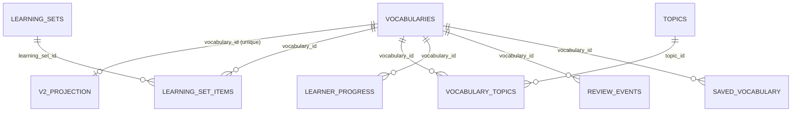

# Audit data local và đề xuất nội dung cho nhiều độ tuổi — 28/10/2026

Phạm vi: mã nguồn trong `D:/hoctienganh/VocabFlow`, nhánh `TXH`, PostgreSQL
Docker `127.0.0.1:55432/vocabflow_dev`. Không đọc DB Neon, không gọi website
production, không tạo media, không gọi TTS, không thực hiện migration/import.
Các số dưới đây là **bản local hiện tại**, không phải số liệu website Vercel.
Mã nguồn baseline trước thay đổi: `86a08f1`.

## 1. Kết luận

Kho có khá nhiều nội dung phổ thông nhưng chưa thành bộ học cho học sinh:
7.311 bản ghi nghĩa V2, 6.114 đầu mục khác nhau theo `lower(trim(word))`,
không có gán lớp hoặc nhóm tuổi nào. Có 5.539 nghĩa gắn CEFR và 1.772 nghĩa
chưa phân loại. Thiếu một số từ rất cơ bản trong nguồn V2; nội dung có sẵn
cũng chưa chắc dùng được ngay cho trẻ. Ví dụ `book` nghĩa “quyển sách” và
“đặt chỗ” cùng có A1; câu cho số `one` là “One is an odd number.”

Nên bổ sung chương trình nội dung theo khoảng trống thực tế: tuyển chọn lại
đúng nghĩa có sẵn, viết thêm mục còn thiếu, chuẩn bị bản diễn đạt phù hợp
người học, sau đó mới tạo ảnh/âm thanh cho bản nội dung đã duyệt. Không cần
nhân bản toàn bộ từ vựng cho từng lớp.

## 2. Bằng chứng và khả năng tái kiểm tra

- [metrics.json](metrics.json): kết quả và toàn bộ câu SELECT.
- [audit-local-content.mjs](audit-local-content.mjs): chỉ đọc file kết nối
  local chuyên dụng; từ chối host ngoài localhost, port/database khác; bỏ qua
  `DATABASE_URL` của shell và các `.env` remote.
- Chạy từ gốc repo: `node docs/audits/local-content-audit-2026-10-28/audit-local-content.mjs`.
- PostgreSQL xác nhận `transaction_read_only=on`, isolation `repeatable read`;
  statement timeout 30 giây. Không xuất connection string, mật khẩu, danh tính
  người học hoặc dữ liệu tài khoản.
- Chuẩn hóa đầu mục ở đây chỉ là chữ thường và bỏ khoảng trắng đầu/cuối;
  không phải kiểm định rằng các đầu mục là các Lexeme chuẩn khác nhau.

Container local có sẵn được khởi động để đọc. Nội dung DB không thay đổi.
Số 4.537 từ/11 bộ trong tài liệu 21/10 là bằng chứng lịch sử của một lần
đọc khác; không thay thế kết quả local này. Changelog 20/10 nói về xử lý
Development/Production Neon, không chứng minh bản Docker đã nhận thay đổi đó.

## 3. Số liệu hiện tại

| Chỉ số | Kết quả |
| --- | ---: |
| Tổng hàng `vocabularies` | 7.341 |
| Hàng V2 đang bật | 7.311 |
| Hàng starter/legacy đang bật | 30 |
| Đầu mục V2 chuẩn hóa | 6.114 |
| Đầu mục V2 có nhiều nghĩa/hàng | 851 |
| Số hàng vượt mức một hàng/đầu mục | 1.197 |
| Số nghĩa tối đa của một đầu mục | 6 |
| Nghĩa V2 có lớp / nhóm tuổi | 0 / 0 |
| Nghĩa V2 có nghĩa Việt, định nghĩa Anh, ví dụ | 7.311 |
| Ví dụ cấu trúc có cả khóa `en`, `vi` không trống | 7.313 |
| Nghĩa V2 có IPA / ảnh / audio từ / audio ví dụ trong DB local | 0 / 0 / 0 / 0 |
| Bộ học tổng cộng / bộ có nội dung V2 | 15 / 10 |
| Nghĩa V2 trong ít nhất một bộ đang bật | 5.594 |
| Nghĩa V2 ngoài mọi bộ đang bật | 1.717 |
| Chủ đề / liên kết từ–chủ đề | 36 / 1.768 |
| Nghĩa V2 liên kết ít nhất một chủ đề đang bật | 1.604 |

Các kiểm tra completeness xác nhận trường có dữ liệu, không xác nhận câu tự
nhiên, nghĩa chính xác hay phù hợp độ tuổi. Chưa nghe/xem media hoặc kiểm tra
CDN: các URL và mảng media local đều trống. Không suy ra production thiếu media.

| CEFR | Số nghĩa V2 | Đầu mục trong mức |
| --- | ---: | ---: |
| A1 | 1.008 | 699 |
| A2 | 905 | 676 |
| B1 | 740 | 584 |
| B2 | 1.424 | 1.222 |
| C1 | 1.462 | 1.254 |
| C2 | 0 | 0 |
| Pre-A1 | 0 | 0 |
| Chưa biết | 1.772 | 1.712 |

Một đầu mục có thể xuất hiện ở nhiều CEFR qua các nghĩa khác nhau, nên không
cộng cột đầu mục để suy ra tổng kho. Các 5.539 CEFR có metadata trạng thái
`SOURCE_VERIFIED`; audit xác nhận nhãn/bằng chứng được lưu, chưa đối chiếu độc
lập từng nguồn gốc. `UNKNOWN` không có nghĩa Pre-A1 hoặc quá dễ.

## 4. Quan hệ dữ liệu đang hoạt động

- `vocabularies.id` là danh tính runtime; `word` không unique. Một hàng V2
  tương ứng một nghĩa/proposal, không mặc nhiên là một từ duy nhất.
- `master_v2_development_projections` giữ `proposal_key` unique, POS, CEFR,
  ví dụ song ngữ, hash nội dung, provenance và media theo nghĩa.
- Master thiết kế đầy đủ có Lexeme → nhiều Sense; bản Docker này không có
  các bảng Lexeme/Sense chuẩn hoặc editorial staging tương ứng. Nó chứa bản
  chiếu runtime. Không nhầm schema thiết kế với bảng đã có dữ liệu.
- `master_vocabulary_mappings`, `master_learning_set_memberships` và
  `master_vocabulary_topic_memberships` hiện đều 0 hàng. Pipeline bridge
  canonical khác pipeline V2 projection đang chứa 7.311 hàng.
- Một nghĩa dùng được trong nhiều bộ học; thứ tự thuộc `learning_set_items`.
  Gán bộ cho người học nằm ở `learner_learning_sets`, khác phân loại nội dung.
- Tiến độ account unique theo người học × `vocabulary_id`; lịch sử và lưu từ
  cũng tham chiếu ID này. Đổi lớp/bộ không phải lý do đổi ID hay reset tiến độ.
  Guest lưu theo danh tính nội dung trong trình duyệt, cần giữ tương thích.
- Không tìm thấy liên kết mồ côi trong 9 kiểm tra projection, set item,
  topic link, progress, review và saved → vocabulary/cha tương ứng. Đây là
  kiểm tra các cạnh được liệt kê, không phải chứng nhận toàn bộ DB.

Mã liên quan: `apps/api/src/db/schema.ts`, `vocabulary-dataset-version.ts`,
`vocabulary.ts`; thiết kế Master ở `docs/architecture/master-vocabulary-v2-data-dictionary.md`.

## 5. Phát hiện cần xử lý

### DB local cũ hơn mã hiện tại

Không có bảng `master_v2_short_meanings`, cột `topics.review_status`,
`topics.parent_topic_id`, `vocabulary_topics.review_status`, hoặc
`learner_profiles.flashcard_display_mode`. Repo đã có migration 0019–0021
cho các thay đổi này. Mã đọc vocabulary hiện JOIN bảng short meanings;
topic policy đọc trạng thái duyệt. Những đường đọc đó không tương thích
với schema local đang audit. Không dùng một bản UI/API bị lỗi schema để kết
luận rằng dữ liệu không tồn tại. Chưa áp dụng migration trong audit.

36 chủ đề và 1.768 liên kết hiện có chưa có trường trạng thái mới: không thể
đếm chúng là “chủ đề đã duyệt”. Migration có quy tắc bảo toàn bằng chứng,
không phải lệnh duyệt tất cả.

### Bộ lọc lớp thiếu cả mô hình lẫn nội dung

- Enum DB, shared contracts và UI chỉ nhận `GRADE_1`–`GRADE_5`, `GENERAL`.
  Thêm option lớp 6–12 vào dropdown không đủ: parser và DB vẫn không nhận.
- API lọc lớp bằng `v.level`; tất cả 7.341 hàng hiện NULL. Metadata V2
  `schoolGrades` và `ageGroups` cũng rỗng ở mọi projection.
- Có bộ legacy tên “Bộ từ khởi đầu lớp 1”, grade `GRADE_1`, 10 mục. Cả 10
  thuộc legacy; V2 predicate loại chúng. Nhãn lớp của bộ không tự phân lớp
  các từ bên trong hoặc khiến chúng xuất hiện ở kho V2.
- Builder chủ động để `ageGroups: []`, `schoolGrades: []`, set grade NULL.
  Đây là dữ liệu chưa được biên tập, không phải suy luận lớp thất bại.
- Master hỗ trợ nhiều SCHOOL_LEVEL cho một Sense, nhưng legacy transform
  chọn một gán primary và chỉ chiếu lớp 1–5; mất thông tin nhiều lớp/6–12.
- Một số nơi lấy `grade.slice(-1)` để hiện số lớp. Mở rộng thẳng sẽ làm
  lớp 10/11/12 hiện sai thành lớp 0/1/2.

### CEFR và độ phù hợp tuổi khác nhau

`book` (VERB) và `book` (NOUN) cùng A1, nhưng pilot trẻ cần đúng nghĩa danh từ.
`apple` có nghĩa Việt dạng giải thích dài; nhiều ví dụ có cấu trúc/khái niệm
chưa phù hợp bài đầu tiên. Cần kiểm duyệt từng nghĩa và cách trình bày,
không chọn toàn bộ A1 làm bộ lớp 1.

Master taxonomy nhận `PRE_A1`, nhưng browse contract dùng regex
`/^[ABC][12]$/`, không nhận Pre-A1. Muốn hỗ trợ phải sửa xuyên suốt contract,
API, guest index, chọn queue và UI; không đổi nhãn đơn thuần.

### Kho thiếu những mục rất cơ bản

Kiểm tra mẫu 35 đầu mục, không phải danh sách chuẩn chương trình:
V2 thiếu `cat`, `hello`, `hand`, `mouth`, `seven` và các đầu mục `a/b/c`.
`cat` có trong 30 starter legacy nhưng không được chọn bởi nguồn V2.
Có `one` nhưng ba nghĩa NUMBER/DETERMINER/PRONOUN; phải chọn đúng NUMBER.
`zero` hiện A2, là ví dụ việc số đơn giản cho trẻ không tương đương nhãn A1.
Không có đầu mục `a/b/c` cũng chưa tự chứng minh loại bài tên chữ/âm đã được
mô hình hóa: khái niệm chữ A phải khác từ/mạo từ a.

### Đếm nghĩa và nhóm từ chưa thống nhất

API đếm/phân trang hàng nghĩa trước; `groupVocabularyByHeadword()` chỉ nhóm
những hàng đã tải ở trang đó. Một đầu mục nhiều nghĩa có thể bị chia trang,
và nhãn “số từ” không khớp đơn vị đếm. Không xóa nghĩa chỉ để làm số đếm đẹp.
Đề xuất phân trang theo đầu mục khi browse nhóm; học vẫn theo đúng nghĩa/ID.

### Trạng thái nội dung/media chưa phải trạng thái phát hành

7.311 projection đều `PASS / DRAFT / UNKNOWN_REVIEW_REQUIRED`.
PASS nội dung không tương đương duyệt độ tuổi hoặc quyền sử dụng media.
DEC-032 có cơ chế owner attestation riêng cho media V2; không yêu cầu người
dùng xác nhận lại media đã được ủy quyền đó, cũng không đổi UNKNOWN thành
giấy phép verified. Nội dung/media mới dùng quy trình tạo và duyệt riêng.

## 6. Quyết định đã chốt trong lần audit này

1. Tái sử dụng đúng nghĩa phù hợp có sẵn; viết mới phần thiếu. Chữ cái,
   tên chữ, âm cơ bản là nội dung làm quen riêng; không trộn với mạo từ.
2. Một nghĩa có thể dùng cho nhiều lớp/bộ học, giữ chung danh tính và tiến độ.
   Nội dung diễn đạt cho trẻ được tuyển chọn trong ngữ cảnh bộ học. Đây là
   quyết định mô hình, chưa phải bảng placement/variant đã triển khai.
3. Bỏ nút “Duyệt theo chủ đề” trong ảnh ở đầu trang Vocabulary. Không có yêu
   cầu xóa taxonomy, liên kết DB hoặc lịch sử học. Việc xóa toàn bộ route
   Topics không được suy ra từ yêu cầu bỏ nút này.

Xem [ADR-0002](../../adr/0002-reuse-senses-across-school-placements.md).
Pilot khoảng 30 từ/bốn chủ đề, tự chọn, không tuyên bố bám sách cụ thể đã
được chốt từ trước trong US-62; giữ nguyên làm bước kiểm chứng đầu tiên.

## 7. Bộ lọc theo mức học — đã được chủ sản phẩm chốt

Chủ sản phẩm muốn các mức dễ hiểu thay vì lấy lớp làm bộ lọc chính; yêu cầu
chi tiết hơn phương án bốn mức rồi bảy mức và đã xác nhận **chín mức** sau:

| Mức | Nguồn nội dung / cách xác định |
| --- | --- |
| 1. Làm quen chữ và âm | Nội dung làm quen được biên tập; phân biệt tên chữ và âm |
| 2. Từ đầu tiên | Số, màu sắc, đồ vật quen thuộc; chọn đúng nghĩa và ngữ cảnh |
| 3. Câu đầu tiên | Chào hỏi, giới thiệu, mẫu câu rất ngắn; không chỉ gắn nhãn cho ví dụ hiện có |
| 4. Sơ cấp | CEFR A1 |
| 5. Cơ bản | CEFR A2 |
| 6. Trung cấp | CEFR B1 |
| 7. Trên trung cấp | CEFR B2 |
| 8. Nâng cao | CEFR C1 |
| 9. Chuyên sâu | CEFR C2 |

“Chưa phân loại” là trạng thái riêng, không phải mức thấp nhất. Ba mức đầu
là vị trí học được tuyển chọn, không tự được tuyên bố là CEFR Pre-A1.
Không lấy người lớn mới học ra khỏi nội dung nền tảng; nội dung cho trẻ/người
lớn có thể có ví dụ, cách hỗ trợ và hình minh họa khác nhau.

US-63 triển khai bộ lọc chính theo hệ đã chốt: sáu nhóm CEFR dùng đúng query
identity hiện có và không có dropdown CEFR chính thứ hai. Ba mức đầu chưa có
mô hình nội dung đã công bố nên hiện “Chưa có nội dung” và chưa chọn được;
không tự lấy các từ thiếu CEFR vào đó. Lớp/chủ đề nằm trong “Lọc bổ sung”,
mở khi có ràng buộc đang áp dụng. Việc biên tập placement/variant của ba mức
đầu vẫn thuộc đợt dữ liệu tiếp theo, không đổi danh tính hoặc đơn vị tiến độ.
Lớp học là chiều tùy chọn có bằng chứng, không suy ra lớp từ mức/CEFR.
Chỉ hiện số lượng thật của nội dung đủ điều kiện; chưa có C2 hay nội dung
nền tảng thì ghi “Chưa có”, không tạo cảm giác bộ đã tồn tại.

## 8. Phương án mở rộng dữ liệu

### Bước 1 — Hòa giải local và lập ma trận thiếu

Giữ bản audit làm baseline; rà soát migration local đúng quy trình trước
khi chạy mã mới. Chọn đúng dataset V2/legacy, so khớp starter có thể tái dùng
với canonical identity; không copy cả 30 từ starter rồi tạo bản trùng V2.
Lập manifest theo mục tiêu học: item đã có, đúng Sense hay chưa, ví dụ/độ
tuổi, placement, tình trạng âm/ảnh, review và khả năng dùng trong exercise.

### Bước 2 — Hoàn thành pilot trước khi tăng số lượng

Dùng khoảng 30 mục/bốn chủ đề đã thống nhất để kiểm tra toàn bộ vòng đời.
Từng mục có nghĩa Việt ngắn, một ví dụ Anh–Việt nguyên bản phù hợp tuổi,
quyết định lớp/đối tượng có lý do, và media phù hợp khi có. Chưa chốt bốn
chủ đề cụ thể trong lần audit này. Sau pilot mới đề xuất mục tiêu mỗi đợt
50–100 mục được duyệt; đây là cỡ đợt gợi ý, không phải chỉ tiêu chương trình.

Phát triển lớp 1–2 trước, rồi 3–5, 6–9, 10–12 và sinh viên theo từng khoảng
trống. Từ vựng và độ khó không tự xác nhận bám sát sách/chương trình chính thức.
Nội dung nền tảng về chữ/âm/câu có thể cần loại learning item và tiến độ hoạt
động riêng; chưa ép nó vào mô hình flashcard nghĩa hiện tại hoặc sửa SRS.

### Bước 3 — Dùng ChatGPT Work để tạo bản nháp có cấu trúc

Giao từng nhóm nhỏ 20–30 mục, kèm danh sách nghĩa hiện có và danh sách thiếu.
Yêu cầu: objective, loại mục, Sense tham chiếu nếu có, nghĩa Việt ngắn,
ví dụ gốc Anh–Việt, nhóm người học/lớp đề xuất với lý do, chỉ dẫn ảnh,
nội dung chính xác cần đọc, và các điểm còn chưa chắc. Không cho mô hình
tự tạo ID canonical hoặc tuyên bố nguồn/sách/CEFR đã xác minh.

JSON sinh ra đi vào draft manifest, không ghi trực tiếp vào runtime DB.
Kiểm tra trùng/refs/schema bằng máy; nghĩa, độ tự nhiên và độ phù hợp tuổi
cần lượt review độc lập. Nếu cùng nghĩa chỉ cần ví dụ đơn giản hơn, dùng
biến thể sư phạm có revision/tham chiếu; nếu thực sự là nghĩa mới, tạo Sense
mới. Không ghi đè bản nghĩa dành cho người học khác chỉ để rút gọn cho trẻ.

### Bước 4 — TTS và ảnh sau khi nội dung ổn định

Tận dụng manifest/media planning của US-57 thay vì gọi API ở mỗi lượt học.
Sinh một lần, kiểm tra rồi cache/phân phối. Chọn nhà cung cấp, giọng/accent
và hạn mức chi phí khi bắt đầu đợt sinh; audit này chưa chọn hoặc gọi provider.

Mỗi yêu cầu âm thanh cần loại âm, text, locale, pronunciation identity hoặc
exampleKey, voice/model, phiên bản cấu hình. Hash yêu cầu dùng để chống gọi
lặp; hash bytes trả về dùng để định danh asset. Âm từ có thể dùng chung khi
phát âm phù hợp; âm ví dụ gắn chính xác bản câu. Sửa câu phải làm lại clip
tương ứng. Tên chữ, âm vị và từ đầy đủ không được dùng chung một clip chỉ
vì trùng ký tự. Kiểm nghe là tiêu chí bắt buộc cho pilot chữ/âm.

Lưu provenance/quyền, bytes hash và review ngữ nghĩa. Chỉ upload/activate
sau khi bản nháp cụ thể được duyệt. Cập nhật content/variant version khi
đáp án hiển thị thay đổi; giữ `vocabulary_id` và lịch sử học cũ.

### Bước 5 — Kiểm tra đường học thực sự

So sánh count ở browse/bộ học/setup/queue cho guest và account; cùng bộ lọc
phải chọn cùng tập danh tính. Empty intersection giữ rỗng. Bài không có audio
không vào exercise nghe; không có ảnh không vào image exercise. Đảm bảo đổi
lớp/bộ không sinh hai tiến độ cho cùng nghĩa. Dữ liệu hết hạn cache phải được
làm mới khi bản nội dung đổi.

## 9. Nguồn ngoài repo để đối chiếu khái niệm

- Council of Europe xác nhận CEFR Companion Volume bổ sung Pre-A1:
  [CEFR Companion Volume](https://www.coe.int/en/web/education/-/common-european-framework-of-reference-for-languages-learning-teaching-assessment-14).
  Không dùng CEFR để suy ra lớp hoặc tuổi.
- Hướng dẫn của Bộ GD&ĐT được Cổng Chính phủ đăng nhấn mạnh làm quen ở lớp
  1–2 và không gây quá tải:
  [Hướng dẫn dạy Ngoại ngữ 1 cấp Tiểu học](https://xaydungchinhsach.chinhphu.vn/huong-dan-to-chuc-day-hoc-cac-mon-ngoai-ngu-1-cap-tieu-hoc-119230810082407558.htm).
  Đây là tham chiếu về hướng tiếp cận, không phải audit đáp ứng chương trình
  hay khẳng định nội dung VocabFlow bám sách chính thức.

## 10. Giới hạn và trạng thái triển khai

Audit completeness/quan hệ đã chạy trên local; kiểm tra nội dung ngữ nghĩa là
mẫu, chưa duyệt từng hàng. Chưa audit production, download media, đánh giá
chất lượng phát âm hoặc tạo dữ liệu mới. Chín mức đã được chốt; bộ lọc được
triển khai trong US-63, còn placement/loại learning item nền tảng chưa triển khai.
Việc bỏ nút ở ảnh được xử lý
riêng theo yêu cầu đã rõ; kết quả kiểm chứng được ghi trong US-59/handoff.

Kiểm chứng phần bỏ nút: 27/27 component tests, 2/2 browser tests ở 375/1440px,
web TypeScript, ESLint cho source thay đổi và build đều qua. Đã xem hai ảnh
browser; test dùng API giả lập, không che giấu hoặc giải quyết chênh lệch schema
local. Kiểm chứng bộ lọc chín mức được ghi riêng trong US-63. Chưa triển khai
lên Vercel hoặc áp dụng migration/backfill.
