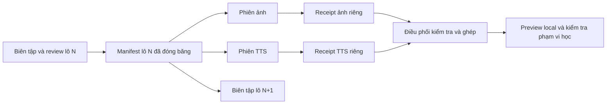

# Hợp đồng điều phối biên tập, ảnh và TTS

**PRODUCTION CONTRACT DRAFT / BOUNDED MOCK CANARY IMPLEMENTED.** Đọc cùng
[bản phân tích](README.md) và [JSON kế hoạch](campaign-plan.draft.json).
[Ticket 03](ticket-03-manifest-canary.md) đã thử hợp đồng bằng ba mục/chín job,
validator, manifest/receipt và worker giả lập; không có provider runtime thật
hoặc quyền bật dữ liệu. Các phần dưới mô tả hướng production, đối chiếu với
báo cáo 03 để biết phạm vi nào đã được chứng minh và phần nào còn nháp.
[Ticket04](ticket-04-frozen-pilot.md) bổ sung manifest bản thảo30 mục và85
yêu cầu media tiềm năng (5 slot ảnh OMIT), review độc lập và package có media
ứng viên. Đây vẫn là preflight không executable: providerRequestHash null khi
chưa chọn cấu hình;05/06 phải cấp work order mới thay vì chạy bản nháp này.
Tiếp tục tuân theo [chính sách ID/version Master V2](../../architecture/master-vocabulary-v2-identity-versioning-policy.md).

## 1. Quan hệ dữ liệu và giới hạn sở hữu

- Một Lexeme có nhiều Sense. Mỗi Sense là một nghĩa học có danh tính lâu dài;
  dùng lại trong nhiều bộ/mức/lớp vẫn cùng ID và tiến độ. Sửa nghĩa Việt ngắn
  hoặc chọn ví dụ dễ hơn không tự tạo một bản sao Sense cho mỗi bộ.
- Example thuộc đúng Sense và có ID riêng. Pronunciation có ID riêng, gắn
  Lexeme hoặc Sense override; cùng chữ chưa chắc cùng cách đọc.
- Bộ học chứa membership tới Sense. CEFR, lớp, chủ đề và tuyển chọn mức nền
  tảng là các chiều riêng, không suy nhãn này từ nhãn kia. Một Sense có thể
  thuộc nhiều tuyển tập; tổng số membership khác tổng số nghĩa duy nhất.
- Bản diễn đạt cho trẻ là ngữ cảnh sư phạm dùng lại Sense. Cấu trúc lưu biến
  thể/placement cần được duyệt trong pilot; chưa khẳng định DB đã hỗ trợ.
- Chữ cái, tên chữ, âm và mẫu câu chưa được mô hình hóa đầy đủ trong runtime.
  Cần item contract riêng trước khi nhập; không ép chữ A thành mạo từ `a`.
- Media có danh tính asset, version, byte hash và delivery riêng. Một URL hoặc
  tên file không phải danh tính nghĩa, phát âm hay bằng chứng được duyệt.

Registry do **một phiên điều phối** sở hữu. Nó lưu crosswalk từ proposalKey,
sourceGroupKey và integer vocabularyId hiện hữu tới Master IDs đã được xác
minh. Không coi proposalKey là UUID. Giữ nguyên ID cũ; trường chưa hòa giải để
PENDING_IDENTITY, không tự tạo lại ID từ headword/hash. Chỉ điều phối cấp UUIDv7
một lần cho thực thể mới sau kiểm tra trùng theo chính sách Master hiện có.

## 2. Một JSON chung, nhiều kết quả độc lập

Mỗi lô có một manifest **bất biến** đã đóng băng; biên tập/ảnh/TTS cùng đọc bản
đó. Worker không sửa manifest, registry hoặc trạng thái tổng hợp. Mỗi worker
ghi receipt riêng; điều phối kiểm tra rồi tạo snapshot kết quả mới.



Manifest tương lai cần tối thiểu:

| Phần | Trường bắt buộc và ý nghĩa |
| --- | --- |
| Ghim nguồn | campaignId, batchId, manifestRevision, schemaVersion, baseline pins; đường dẫn và byte SHA-256 từng input |
| Danh tính | proposalKey/runtime ID nếu có; Master IDs đã xác minh; entity revisions; parent/binding chính xác |
| Nội dung | headword, POS, sense disambiguator, nghĩa Việt, Example ID và câu song ngữ; nội dung chữ/âm/câu có itemType riêng |
| Xếp nội dung | CEFR kèm bằng chứng; placement/membership và review; không dùng tuổi thay độ khó |
| Quyết định | KEEP/REVISE/REVIEW_REQUIRED/RETIRE_WITH_HISTORY; reviewer, lý do, input hash đã review |
| Work order | jobId, kind, target IDs/revisions, dependency pins, request hash, output contract, review và reuse policy |
| Cấu hình media | ảnh: brief/style; âm từ: pronunciation/locale/text/phoneme; âm ví dụ: Example ID và exact English text; voice/provider/model/config được ghim |

Manifest SHA-256 là hash **bytes của file đóng băng**, được ghi trong work order
và receipt bên ngoài file đó. Không tự đặt hash toàn file bên trong chính nó.
Hash input/request dùng thuật toán/canonicalization có tên được chốt ở canary;
không thay thế các hash semantic/release JCS hiện có của Master.

`campaign-plan.draft.json` hiện chỉ là kế hoạch: `items=[]`, `jobs=[]`,
`executionAllowed=false`. Không tự điền provider/voice hoặc chạy vì thấy file.
Manifest canary đã có riêng ở con trỏ trong JSON kết quả 03, dùng thuật toán
`sha256-sorted-json-canary-v1`. Nó không thay hash JCS/canonical Master; mọi
output canary có `mockOnly=true`, `runtimeEligible=false` và MIME JSON.

## 3. Lưu ở đâu, tên như thế nào

Campaign giữ mã `editorial-refresh-20261028` xuyên các ngày; ngày không phải
phiên bản. Mọi đường dẫn bên dưới tính từ gốc repo:

```text
docs/plans/editorial-refresh-2026-10-28/       # phân tích tracked, không chứa raw corpus
vocabflow-dataset/workspaces/editorial-refresh-20261028/
  registry/                                 # điều phối, snapshot có version
  batches/<batchUuid>/manifest-r0001.json    # không ghi đè sau freeze
  packages/<packageUuid>/                    # input bundle có checksum để bàn giao
  results/<batchUuid>/snapshot-r0001.json    # kết quả do điều phối tổng hợp
.vocabflow-local/editorial-refresh-20261028/
  runs/<runUuid>/<jobUuid>/attempt-0001/
    output.png                              # hoặc output.mp3
    receipt.json                            # worker ghi một lần khi kết thúc attempt
  assets/images/<fullOutputSha256>.png
  assets/audio/<fullOutputSha256>.mp3
```

Hai thư mục dữ liệu/binary đều đang bị Git ignore. Worktree mới **không tự có**
những input này. Handoff phải có package bất biến, index path/hash và nơi lưu
được các phiên cùng truy cập; kiểm tra đủ bytes khi nhận. Không coi Git commit
là backup cho chúng. Chọn nơi backup chung trước khi sản xuất thật.

Không dùng headword/proposalKey thô làm tên file: key có thể có `:` và chuỗi
có thể không hợp lệ trên Windows. Dùng UUID và hash; giữ tên dễ đọc trong JSON.
Resolve đường dẫn rồi xác minh nằm trong đúng allowed root, từ chối traversal,
path tuyệt đối từ worker, junction/symlink thoát root và collision khác bytes.
Không ghi đè output của attempt cũ. Điều phối xác minh bytes rồi mới đưa vào
asset store theo output hash; cùng bytes có thể dùng lại một file.

## 4. Receipt, nhận việc và retry

Work order do điều phối cấp cho một worker/lease tại một thời điểm. Receipt
phải có manifest path/hash, jobId, attemptId, workerId, requestHash, target IDs,
relative output path, SHA-256 thực tế, MIME, kích thước bytes, thời gian, cùng
duration đối với audio hoặc dimensions đối với ảnh. Ghi thêm provider request
ID, model/voice/config chính xác, provenance/quyền và kết quả review.

Không đưa secret/API key vào manifest, receipt hoặc log; chỉ tham chiếu tên
credential profile. Provider request ID là dữ liệu đối chiếu, không phải khóa
idempotency được bảo đảm bởi mọi provider.

Trạng thái job đề xuất: PLANNED → CLAIMED → PRODUCED → REVIEW_REQUIRED →
ACCEPTED; FAILED/STALE/REJECTED là nhánh có lý do. ACCEPTED phải có hash bytes,
đúng binding, review nội dung và bằng chứng theo policy áp dụng. Worker không
tự duyệt sản phẩm của chính mình hoặc tự đánh dấu đã xuất bản.

Điều phối từ chối receipt sai batch/manifest/request/target/hash hoặc output
ngoài root. Receipt trùng cùng kết quả được xử lý idempotent; kết quả khác
bytes từ cùng attempt là conflict. Lỗi được ghi bằng attempt mới, không xóa
bằng chứng. Nếu provider đã nhận nhưng timeout chưa rõ kết quả, đối chiếu
request trước khi retry để tránh sinh/trả phí hai lần. Kiểm tra khả năng hỗ trợ
idempotency thực tế của provider tại thời điểm chọn tích hợp.

## 5. Khi sửa nội dung, việc nào phải làm lại

| Thay đổi | Việc bị hết hạn |
| --- | --- |
| Câu tiếng Anh của Example | Audio của đúng Example; ảnh chỉ khi brief dùng ngữ cảnh câu bị đổi |
| Bản dịch Việt, nghĩa học giữ nguyên | Review copy/projection; không mặc định sinh lại ảnh hoặc audio tiếng Anh |
| Pronunciation, locale, voice, rate, phoneme/SSML | Những job audio dùng đúng dependency đó |
| Brief ảnh hoặc style | Những job ảnh dùng đúng dependency đó |
| Bản chất nghĩa/target binding | Review toàn bộ binding/media phụ thuộc; split/merge theo policy ID nếu cần |
| Chỉ đổi delivery URL cùng bytes | Delivery record; không tạo lại nội dung media |

Ảnh dùng brief ngữ nghĩa riêng, tránh buộc prompt phụ thuộc câu ví dụ nếu không
cần. Word audio phải ghim cả pronunciation và phoneme/SSML payload, không chỉ
text/voice/rate; tránh chia sẻ nhầm homograph. Audio ví dụ ghim Example ID và
exact text. Request hash khác output byte hash: chưa có bytes thì chưa có output
hash. Review ngữ nghĩa vẫn cần dù hash đúng.

## 6. Tái sử dụng, tích hợp và tiêu chí chạy lớn

Trước khi tạo mới, kiểm tra media cũ: đúng Sense/phát âm/câu, hash còn khớp,
quyền áp dụng và delivery hợp lệ. DEC-032 đã cho phép đúng phạm vi APKG có
owner attestation; không yêu cầu duyệt lại quyết định cũ chỉ vì chiến dịch mới.
Tuy nhiên attestation này không tự áp dụng cho asset sinh mới.

Pipeline đang đề xuất namespace `vocabflow/{image|audio}/content-v2/<hash>`,
còn sanitizer runtime có namespace signed/authenticated `Vocab/v2/{images|audio}`.
Canary phải kiểm tra adapter và policy riêng cho media sinh mới trước khi tạo
hàng loạt. Không giả trạng thái UNKNOWN_REVIEW_REQUIRED cho asset mới đã có
rights evidence để vượt DTO cũ. Hợp đồng mới được thêm song song, giữ tương thích.

Chỉ chuyển sang lô lớn sau canary ba mục và pilot 30 từ chứng minh: ID/crosswalk
ổn định, job có input pins đúng, ảnh/TTS tới đúng mục, stale/retry được bắt,
runtime đọc được, account/guest giữ cùng phạm vi browse/setup/study và tiến độ
cũ không đổi. Local Docker cần kế hoạch schema tương thích trước demo runtime;
không chạy tự động migration/reset. Review/publish/release vẫn là các cổng riêng.
Ticket 02 đã áp dụng có kiểm soát các migration local 0019–0021 và xác minh
guest browse/setup/study thật. Phần này không nhập content/media, không thay
thế gate item/placement hay adapter media sinh mới của pilot 07.

Ví dụ dự toán công việc, **không phải backlog hay báo giá**: nếu đủ 600 mục đều
cần một âm từ, một âm ví dụ và 60–80% cần ảnh mới, sẽ có khoảng 1.560–1.680 job
trước reuse/retry. Đếm lại sau inventory và pilot; provider/voice/phạm vi ảnh,
ngân sách và việc gọi dịch vụ chưa được chốt.
