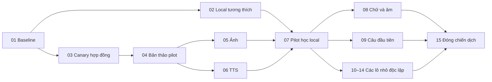

# 15 nhóm việc đã duyệt cho chiến dịch biên tập

**BREAKDOWN APPROVED / LOCAL TICKETS PUBLISHED — chưa bắt đầu thực thi.**
Chủ sản phẩm duyệt sơ đồ và chọn Markdown local ngày 29/10/2026 theo
[skill to-tickets](../../../.agents/skills/to-tickets/SKILL.md).
Xem [phân tích](README.md) và [hợp đồng điều phối](coordination-contract.md).
Đã xuất [15 file ticket riêng và index](../../../.scratch/editorial-refresh-20261028/README.md).
Tài liệu này giữ vai trò tổng quan; trạng thái từng việc nằm trong ticket local.

Mỗi mục cần một đầu ra có thể kiểm tra độc lập. Ticket 10–14 là mẫu lô nhỏ,
được nhân theo danh sách ID đã ghim sau baseline; không giao cả nghìn nghĩa
cho một phiên. Việc ảnh và TTS có work order riêng trong cùng ticket lô.
Các dependency dưới đây là phụ thuộc dữ liệu/kỹ thuật, chưa phải lệnh chạy.

1. **Đóng băng baseline đối chiếu toàn kho**
   - **Blocked by:** Không.
   - **Bàn giao:** Gói baseline tái lập được, giải thích runtime/RC/enrichment/
     legacy/media và ma trận mục tiêu cần biên tập; tách baseline khỏi đề xuất sửa.
   - **Kiểm tra:** Đủ 7.311 ID V2 và 30 legacy được hạch toán; CEFR 1.155 nhãn
     bổ sung/606 C2 được đối chiếu trước quyết định áp dụng. Có crosswalk,
     hash nguồn, trạng thái chưa rõ và quyền sở hữu từng shard; không kích hoạt dữ liệu.

2. **Làm cho local preview đọc đúng baseline và giữ lịch sử**
   - **Blocked by:** 01.
   - **Bàn giao:** Một phạm vi local đại diện đi được browse → setup → study
     bằng schema tương thích với app hiện tại, có quy trình kiểm tra trước thay đổi.
   - **Kiểm tra:** Đúng DB local; snapshot/khả năng phục hồi; chỉ các thay đổi
     schema đã duyệt, không reset lịch sử. ID, số lượng trong scope và tiến độ
     cũ giữ nguyên; không có truy cập DB remote.

3. **Chạy thử hợp đồng bàn giao với ba mục và kết quả giả lập**
   - **Blocked by:** 01.
   - **Bàn giao:** Biên tập, ảnh, TTS giao nhận ba mục hiện có bằng manifest
     chung và receipt riêng; người tích hợp xem được mục nào đủ/thiếu/hết hạn.
   - **Kiểm tra:** Không gọi provider. Sai hash/ID/path/manifest bị từ chối;
     giao lặp không tạo trùng, thay input làm đúng job hết hạn, không mất kết quả
     khi hai worker hoàn tất cùng lúc. Bundle dùng được ở phiên/worktree khác.

4. **Đóng băng bản thảo pilot 30 từ, bốn chủ đề**
   - **Blocked by:** 03.
   - **Bàn giao:** Bản thảo tuyển chọn có thể đọc/review: đúng nghĩa, ngắn gọn,
     ví dụ song ngữ phù hợp trẻ, membership rõ và brief media riêng.
   - **Kiểm tra:** Đã tìm cả headword gốc/alias/legacy trước khi viết mới;
     review độc lập và hash đã đọc được ghi lại. Không gán A1 thành lớp 1;
     mục thiếu bằng chứng vẫn chờ review. Có danh sách media dùng lại/tạo mới/bỏ.

5. **Ảnh pilot có kết quả review và binding kiểm tra được**
   - **Blocked by:** 04.
   - **Bàn giao:** Gallery pilot từ ảnh phù hợp được tái dùng hoặc ảnh mới đã
     được phép tạo, mỗi ảnh truy ngược được mục và brief đã duyệt.
   - **Kiểm tra:** Output có bytes/hash, kích thước, provenance và receipt;
     rõ đường dẫn local và quyền áp dụng. Đúng nghĩa, phù hợp trẻ, không ghi đè;
     abstract có thể bỏ ảnh theo policy đã chốt, không lấy ảnh bất kỳ cho đủ.

6. **Audio pilot có phát âm và câu ví dụ chính xác**
   - **Blocked by:** 04.
   - **Bàn giao:** Playlist pilot nghe được, tách âm từ và âm ví dụ, dùng lại
     clip khớp chính xác hoặc tạo mới theo cấu hình được chốt.
   - **Kiểm tra:** Đúng pronunciation/locale/voice/phoneme và exact English
     example; receipt/hash/duration đầy đủ, review nghe độc lập. Homograph
     không dùng chung sai cách đọc; retry không sinh trùng không kiểm soát.

7. **Pilot đầu tiên hoạt động đầy đủ trong học local**
   - **Blocked by:** 02, 05, 06.
   - **Bàn giao:** Người học chọn bộ pilot ở Từ đầu tiên, xem/học đúng nội
     dung và media được phép; thiếu media được biểu diễn trung thực.
   - **Kiểm tra:** Adapter media sinh mới tương thích nguồn cũ; account/guest
     có scope và số lượng nhất quán, zero-result không mở rộng. Một Sense dùng
     lại vẫn có cùng tiến độ; kiểm tra local trước mọi kế hoạch phát hành.

8. **Làm quen chữ và âm qua một mô-đun nhỏ hoàn chỉnh**
   - **Blocked by:** 07.
   - **Bàn giao:** Một nhóm chữ đầu tiên chọn và học được bằng item model đã
     duyệt, phân biệt tên chữ với âm, trình bày và audio phù hợp.
   - **Kiểm tra:** Không dùng Sense mạo từ thay chữ; mục tiêu từng hoạt động
     rõ, input audio chính xác. Các chữ còn lại thành lô tiếp theo; kiểm tra
     scope/tiến độ với item model riêng trước mở rộng đủ 26 chữ.

9. **Câu đầu tiên qua một mô-đun nhỏ hoàn chỉnh**
   - **Blocked by:** 07.
   - **Bàn giao:** Một nhóm tình huống giao tiếp ngắn chọn và học được, có
     nghĩa/dịch/ngữ cảnh và audio khớp câu đang hiện.
   - **Kiểm tra:** Mẫu câu khuyết có hoạt động và audio được định nghĩa riêng;
     không giả là câu đầy đủ. Dùng lại cụm từ có sẵn khi đúng nghĩa; đếm riêng
     sentence items và lexical additions, không đếm đôi vào mục tiêu 600.

10. **Biên tập một lô A1/A2 tới preview hoàn chỉnh**
    - **Blocked by:** 07.
    - **Bàn giao:** Khoảng 50 Sense cùng shard được KEEP/sửa có chọn lọc,
      có media cần thiết và membership đúng, kiểm tra được trong học local.
    - **Kiểm tra:** Mỗi ID có quyết định và reviewer/hash; các sửa đổi được
      kiểm tra độc lập. Media đúng dependency; nghĩa anh em chỉ đọc để đối chiếu
      nếu thuộc shard khác; không đổi ID/tiến độ khi chỉ sửa copy.

11. **Biên tập một lô B1/B2 tới preview hoàn chỉnh**
    - **Blocked by:** 07.
    - **Bàn giao:** Khoảng 50 Sense được kiểm tra ngữ nghĩa, cách dùng, ví dụ,
      metadata và media, có bằng chứng xem/học trong scope đã chọn.
    - **Kiểm tra:** Hạch toán mọi ID trong lô; không đơn giản hóa mất nghĩa.
      Cụm từ/homograph được đối chiếu, dùng lại media còn đúng; không ghi đè
      công việc shard khác; các sửa đổi có review độc lập.

12. **Biên tập một lô C1/C2 đã hòa giải nguồn**
    - **Blocked by:** 07.
    - **Bàn giao:** Khoảng 50 Sense có độ chính xác ngữ nghĩa/ngữ vực tốt,
      CEFR có bằng chứng và preview học hoàn chỉnh.
    - **Kiểm tra:** Đối chiếu C2 trong enrichment, không viết lại chỉ vì Docker
      chưa có nhãn. Bất đồng nguồn được ghi lại; từ trừu tượng có thể không ảnh
      nếu policy cho phép; mọi sửa đổi có review độc lập.

13. **Xử lý một lô chưa phân loại bằng bằng chứng**
    - **Blocked by:** 07.
    - **Bàn giao:** Khoảng 50 Sense được kiểm tra và có nhãn có căn cứ hoặc
      giữ Chưa phân loại với lý do rõ, hoạt động đúng trong bộ lọc/học local.
    - **Kiểm tra:** Không đổi unknown thành Nền tảng; ưu tiên enrichment đã
      khớp hash. Bất đồng không bị che; mọi ID được hạch toán, mọi thay đổi
      được kiểm tra độc lập và không suy CEFR từ tuổi.

14. **Bổ sung một lô khoảng trống thật 25–50 mục**
    - **Blocked by:** 07.
    - **Bàn giao:** Những từ/cụm từ được xác minh thiếu từ ma trận phủ trở
      thành nội dung học hoàn chỉnh, có bộ tuyển chọn và media cần thiết.
    - **Kiểm tra:** Tìm cả canonical headword, alias, biến hình, đúng Sense
      và starter; cấp ID một lần. Có 100% review độc lập phần mới, copy nguyên
      tác/provenance, counts tách Lexeme/Sense/phrase/variant; mục mới qua local
      scope và media gates trước khi được tính là hoàn thành.

15. **Đóng chiến dịch với coverage và gói bàn giao tái lập**
    - **Blocked by:** 08, 09 và **mọi instance 10–14** nằm trong phạm vi đã chốt.
    - **Bàn giao:** Báo cáo toàn kho và gói nội dung/media tái lập, 25–35 bộ
      học tuyển chọn cùng mức mở rộng thực tế sau đối chiếu.
    - **Kiểm tra:** Mọi ID baseline có disposition; KEEP/sửa/chờ/retire cộng
      đúng baseline, số mới không tính trùng. Không nhận cả kho xong nếu còn lô
      chưa review; chạy lại không nhân bản, đường dẫn/hash đủ, có backup các
      artifact bị Git ignore. Quyết định phát hành tách riêng khỏi hoàn tất local.

## Những việc có thể chạy song song

Sau baseline, 02 và 03 độc lập. Sau bản thảo, ảnh và TTS pilot độc lập. Sau
pilot, các shard review và viết mới chạy song song; lô N đóng băng thì ảnh/TTS
làm N trong khi tác giả làm N+1. Có thể bắt đầu bằng bốn vai trò: điều phối,
biên tập, ảnh, TTS; thêm reviewer độc lập theo tài nguyên. Một phiên không tự
đóng vai reviewer độc lập cho chính nội dung nó vừa sửa.

Với khoảng 7.311 Sense, các instance review dự kiến khoảng 147–150 lô, không
phải chỉ bốn việc “review A1…unknown” khổng lồ. Bản thực thi phải có lịch và
ID từng shard, bao gồm legacy riêng, cùng checklist phủ toàn kho. 15 mục trên
là cấu trúc công việc, không phải cam kết toàn bộ chiến dịch vừa 15 context.

Provider/voice, phạm vi ảnh, ngân sách và cho phép gọi dịch vụ là các cổng ngoài
DAG cần chốt trước 05/06 nếu sinh mới. Không bắt hai nhánh chờ nhau chỉ vì
chúng dùng chung manifest. Chưa đo throughput pilot nên chưa chốt ETA.

## Trạng thái bàn giao

Đã duyệt độ lớn lô, các cạnh phụ thuộc và tracker local; đã xuất **một file mỗi
ticket** theo thứ tự 01–15. Tất cả là `planned` và chưa được giao thực thi.
Cấu hình tracker/triage áp dụng cho chiến dịch này, không tự đặt mặc định cho
mọi việc của repo. Hợp đồng item/media, voice/provider, ngân sách và các gói
shard vẫn cần chốt trong phạm vi thực thi sau; approval xuất ticket không
tự chuyển story thành READY FOR IMPLEMENTATION.
