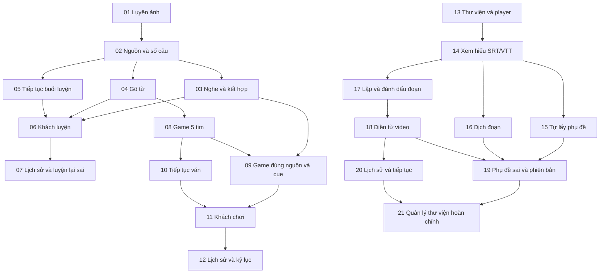

# Sơ đồ 21 ticket đã duyệt — Luyện tự do, Game bắn cá, Học YouTube

Status: APPROVED BREAKDOWN — chủ sản phẩm duyệt sơ đồ và xuất Markdown local.
Ngày: 2026-11-01. Nguồn: [spec đã tổng hợp](spec.md), 90 user stories.
Execution authorized: no. Xuất 21 ticket `planned` vào tracker
`practice-game-video-20261101`; chưa giao code hoặc tạo issue ở dịch vụ ngoài.
Entry point: [tracker đã xuất](../../../.scratch/practice-game-video-20261101/README.md).

## Cách đọc và nguyên tắc chia

- Mỗi ticket là một hành vi hẹp có thể demo hoặc kiểm chứng từ UI đến lưu kết
  quả/API và kiểm thử; schema chỉ thay khi hành vi cần, không chia ticket UI/API/DB
  ngang lớp. Không có ticket chỉ tạo bảng hoặc chỉ dựng mock rồi gọi là xong.
- Tái dùng auth, nguồn từ, hiển thị bài tập và kiểm thử hiện hữu. Không cần
  refactor rộng trước; tách hẹp phần phụ thuộc SRS nằm trong lát cắt 01, giữ
  đường học/ôn cũ xanh. Nếu phát hiện refactor rộng thật sự, trình lại kế hoạch
  expand–contract có bằng chứng, không mở phạm vi ngầm.
- `Blocked by` chỉ là ticket thật sự cần về kỹ thuật; ticket không có blocker
  là có thể chuẩn bị story khi được giao, không phải chỉ thị bắt đầu ngay.
- **Thứ tự sản phẩm vẫn Luyện tự do → Game → Video.** Hoàn tất nhóm trước để
  chuyển nhóm sau theo kế hoạch. Không thêm cạnh giả giữa các nhóm độc lập chỉ
  để ép thứ tự; nghiên cứu nguồn/quota không trả phí có thể chuẩn bị trước.
- Trước khi thực thi từng ticket: có story/hợp đồng kỹ thuật phù hợp, đọc các
  baseline và đạt gate của repo. Không đoán tên bảng/endpoint/migration trong đề xuất.
- Đã duyệt Markdown local: xuất một file mỗi ticket vào tracker mới của nhóm
  tính năng, dùng ID 01–21 riêng; không sửa ticket 01–15 của chiến dịch biên tập.
  Trạng thái xuất đã duyệt `planned`, `Execution authorized: no`; chỉ sẵn sàng thực
  thi khi được giao và đủ gate, không đồng nhất việc xuất ticket với giao code.

## Tiêu chí chung thuộc mọi ticket

- UI → API/luật có thẩm quyền → lưu/đọc lại → kiểm thử hành vi đi cùng lát cắt;
  trường hợp chỉ ảnh hưởng phía khách vẫn kiểm chứng qua UI và lưu cục bộ.
- Dữ liệu riêng kiểm tra auth/quyền sở hữu hiện hữu; không tin ID hoặc điểm/
  tim/đúng-sai do client tự nhận. Logout/đổi tài khoản không lộ dữ liệu trước đó.
- Luyện/game/video không thay ngày ôn, revision học chính, số từ đã học, XP,
  chuỗi hoặc từ yếu/lịch sử của Ôn theo lịch. Kiểm tra tác dụng phụ ở API khi có ghi.
- Không lộ đáp án qua nhãn/alt/trợ năng; mobile, bàn phím, focus và các trạng
  thái loading/error/empty/success thuộc tính năng, không dồn sang ticket cuối.
- Retry/save cần idempotency ngay khi bắt đầu ghi dữ liệu; không hoãn quyền
  truy cập/chống ghi trùng đến một ticket hardening sau cùng.
- Web/API là seam nghiệm thu đã duyệt; mock provider/player ở biên I/O, không
  mock từng helper. Provider live chỉ được xác minh trong quota đã kiểm tra,
  không gọi trả phí hoặc tuyên bố mock pass là tích hợp thật hoàn tất.
- Mỗi ticket cập nhật story/bằng chứng và các tài liệu bàn giao cần thiết. Không
  tự commit/push/deploy, chạy migration cloud hoặc tạo media mới từ đề xuất này.

## Nhóm A — Luyện tự do: 01–07

### 01: Hoàn thành một buổi luyện ảnh chọn từ cho tài khoản

**Blocked by:** None.

**What it delivers:** Người có từ đã học mở một buổi luyện ảnh 10 câu, chọn từ,
xem phản hồi và tổng kết; kết quả riêng được ghi mà tiến độ học/ôn giữ nguyên.

**Spec stories:** 1, 2, 5, 8, 11, 12, 17, 19, 20, 21, 22, 26, 28.

- [ ] Dùng nguồn đã học, tối đa 10 mục không lặp; hiện số thực có, không lấy mục
  khác để lấp. Nguồn rỗng báo rõ, không tự tạo buổi hoặc gọi toàn kho.
- [ ] Câu ảnh có bốn từ rõ ràng; không tạo câu nếu lựa chọn/media không hợp lệ.
  Đúng/sai lần đầu, Đã xem và bỏ qua được phân biệt, có tổng kết tỷ lệ đúng chuẩn.
- [ ] Có lát cắt lưu riêng cho tài khoản và API có thẩm quyền; submit/retry không
  ghi trùng, lỗi lưu giữ hành động chờ. Không gọi đường ghi review để lưu kết quả.
- [ ] Tách tối thiểu phần dùng lại bị gắn SRS, không đổi đường học/ôn hiện có;
  kiểm tra API quyền hạn và trạng thái học chính trước/sau buổi.
- [ ] Demo từ mở buổi đến tổng kết/lưu; có E2E hành vi, không chỉ kiểm thử bộ sinh câu.

### 02: Chọn nguồn và quy mô buổi luyện đúng phạm vi

**Blocked by:** 01.

**What it delivers:** Người học chọn nguồn đã học/bộ học/mức học/từ đã lưu và
5/10/20/30 câu; buổi ảnh thực sự dùng đúng phần giao và số mục đủ điều kiện.

**Spec stories:** 3, 4, 10, 13, 14.

- [ ] Mặc định đã học, 10 câu; chưa có từ đã học thì chọn rõ nguồn khác để bắt đầu.
- [ ] Lọc nguồn và điều kiện đủ nội dung trước tạo buổi; hiển thị số thực có,
  không mở rộng nguồn hay đổi kiểu trả lời khi ít lựa chọn.
- [ ] Lưu nguồn/cấu hình/danh tính nội dung với buổi; API không nhận ID nằm ngoài
  nguồn đã được phục vụ hoặc chỉ tin danh sách target do client tự gửi.
- [ ] Hợp đồng câu hỏi/nguồn phân biệt gợi ý và kiểu trả lời đủ rõ để mở ảnh,
  nghe, kết hợp và gõ ở các lát cắt sau mà không gắn lại với review queue writer.
- [ ] E2E nguồn sáu mục/yêu cầu mười, giao nguồn rỗng, từ đã lưu và mức không
  phù hợp cho kết quả thật trên UI và bản lưu.

### 03: Luyện nghe và luân phiên ảnh/nghe với lựa chọn từ

**Blocked by:** 02.

**What it delivers:** Người học hoàn thành buổi nghe hoặc kết hợp bằng lựa chọn
từ, nghe lại và xử lý media lỗi mà giữ đúng chế độ đã chọn.

**Spec stories:** 6, 7, 15, 16, 18.

- [ ] Nghe dùng audio đọc từ; kết hợp luân phiên ảnh/nghe trong nguồn và không
  lặp mục lượt đầu; không dùng nghĩa Việt để thay gợi ý lỗi.
- [ ] Kết hợp cần đủ hai loại và hai mục khác nhau; không đủ thì người dùng chủ
  động đổi thiết lập. Không tự chạy thành buổi một loại hoặc nhân đôi một từ.
- [ ] Nghe lại không phạt; tải lại/bỏ qua lỗi kỹ thuật tách khỏi sai/bỏ qua chủ động.
- [ ] Kết quả gắn đúng loại cue, xuất hiện trong tổng kết và lưu/đọc lại được.
- [ ] Kiểm tra phát lỗi, retry, thiếu một loại, nhãn trung tính và đường ghi riêng.

### 04: Gõ từ tiếng Anh trong buổi luyện đã chọn

**Blocked by:** 02.

**What it delivers:** Người học chọn gõ thay cho bốn lựa chọn và nhận phản hồi
đúng theo từ/biến thể hợp lệ; cơ chế áp dụng theo hợp đồng cue của buổi luyện.

**Spec stories:** 9, 17, 19.

- [ ] Gõ có vòng trả lời/phản hồi/tổng kết/lưu hoàn chỉnh trên cue đã khả dụng;
  không phụ thuộc component lựa chọn hay nhận cờ đúng/sai từ client.
- [ ] Chuẩn hóa hoa/thường, Unicode và khoảng trắng; không tự chấp nhận từ gần
  giống hoặc đồng nghĩa ngoài nguồn biến thể. Nhập rỗng không chấm sai.
- [ ] Đúng/sai lần đầu, Đã xem và retry giữ cùng quy tắc với câu lựa chọn.
- [ ] Ảnh và audio có cùng hợp đồng gợi ý; kiểm chứng cue audio ở biên I/O có
  điều khiển, ghép luồng nghe/kết hợp thực khi 03 có mặt. Không lộ đáp án qua UI.
- [ ] Không thêm phụ thuộc 03 chỉ vì cả hai mở kiểu câu mới; thống nhất hợp đồng
  từ 02 trước khi triển khai hai nhánh, ghép kiểm tra đủ các tổ hợp ở nghiệm thu nhóm.

### 05: Lưu và tiếp tục buổi luyện tài khoản trên cùng thiết bị

**Blocked by:** 02.

**What it delivers:** Người học thoát/tải lại rồi tiếp tục đúng câu, thiết lập
và kết quả lần đầu; lỗi mạng không làm mất hoặc nhân câu đã trả lời.

**Spec stories:** 26, 27.

- [ ] Giữ nguồn/cấu hình/cue/đáp án đầu/vị trí và hành động chờ; không sinh lại
  bộ câu khác khi khôi phục cùng buổi.
- [ ] Tải lại sau câu đã lưu không cho giải quyết lại để tăng đúng; retry sau
  mất phản hồi không ghi hai lần và chỉ tiến khi lưu thành công.
- [ ] Dùng được với hợp đồng cue/kiểu trả lời của 02; nội dung stale hoặc dữ liệu
  tiếp tục không còn hợp lệ được báo rõ, không tự thay target.
- [ ] Buổi hoàn tất không được mở thành buổi dở; đổi tài khoản không lộ checkpoint.
- [ ] Kiểm tra lỗi lưu, reload và khôi phục; không hứa nối buổi dở giữa hai máy.

### 06: Khách luyện đầy đủ với lịch sử và tiếp tục trên thiết bị

**Blocked by:** 03, 04, 05.

**What it delivers:** Khách dùng các kiểu luyện đã có, lưu kết quả/cursor trên
thiết bị và tiếp tục mà không ghi dữ liệu riêng của tài khoản.

**Spec stories:** 25, 26, 27.

- [ ] Cùng quy tắc nguồn, số câu, cue, kiểu trả lời và tổng kết; nguồn đã học
  được hiểu từ trạng thái khách, không mượn tiến độ của tài khoản trước.
- [ ] Lưu riêng kết quả luyện/checkpoint với dữ liệu học/ôn hiện hữu của khách;
  lỗi persistence giữ câu và hướng dẫn thử lại, không bỏ mất kết quả ngầm.
- [ ] Reload tiếp tục, xóa dữ liệu máy không được hứa khôi phục; không có private
  API writes từ khách hoặc tự chuyển lịch sử khi đăng nhập.
- [ ] Kiểm tra UI ở ảnh/nghe/kết hợp và chọn/gõ, đồng thời guest SRS/XP/chuỗi giữ nguyên.

### 07: Xem lịch sử, từ cần luyện thêm và luyện lại câu sai

**Blocked by:** 06.

**What it delivers:** Tài khoản và khách xem lại buổi luyện, chọn câu sai để
luyện tiếp, có lịch sử lượt mới và giữ nguyên kết quả ban đầu.

**Spec stories:** 23, 24, 29.

- [ ] Tài khoản lưu/đọc lịch sử riêng qua API; khách đọc bản lưu máy; kiểm tra
  quyền truy cập và không tự hợp nhất hai ngữ cảnh.
- [ ] Tổng kết tách đúng/sai/Đã xem/bỏ qua/lỗi, mẫu số 0 không có phần trăm giả.
  Danh sách cần luyện thêm xuất phát từ kết quả luyện, không sửa từ yếu SRS.
- [ ] Luyện lại sai giữ nguồn và kiểu luyện phù hợp, tạo lượt mới; không ghi
  đè kết quả đầu. Nội dung nghỉ phục vụ/media thiếu phải được báo rõ.
- [ ] Demo từ lịch sử → lượt luyện lại → lịch sử mới, có account/guest và lỗi lưu.
- [ ] Nghiệm thu nhóm A bao gồm ghép các tổ hợp đã xây, reload, mobile/trợ năng,
  auth và không có tác dụng phụ lên SRS/XP/chuỗi; không tạo ticket kiểm thử rỗng riêng.

## Nhóm B — Bắn cá điền từ: 08–12

### 08: Chơi một ván bắn cá 5 tim bằng ảnh và gõ từ

**Blocked by:** 04.

**What it delivers:** Tài khoản chơi được một ván theo ảnh, gõ đúng tự bắn và
cộng điểm, sai/xem/bỏ qua mất tim, về 0 kết thúc với tổng kết riêng.

**Spec stories:** 30, 31, 32, 33, 34, 35, 37, 38, 39, 50, 51.

- [ ] Ván mới 5 tim/0 điểm; đúng +10 một lần, sai/xem/bỏ qua chủ động −1 tim
  rồi hiện đáp án và chuyển mục nếu còn tim; không +5 sửa sai/combo/hồi tim.
- [ ] Không ngắm riêng/đếm ngược/cá thoát vì gõ chậm; có giảm chuyển động.
  Gõ ký tự, replay và ô trống không giải quyết cá hoặc mất tim.
- [ ] API kiểm tra luật/trạng thái/nội dung tài khoản; không tin điểm/tim do
  client tự nhận. Retry không nhân điểm, tim hoặc kết thúc thua.
- [ ] Cơ chế chọn/cycling tối thiểu giữ trong nguồn đã học của ván để chơi liên
  tục; 09 mở đầy đủ nguồn/âm thanh/thứ tự đã học → chưa học, không tạo luật ván cố định.
- [ ] Tổng kết ván đúng trạng thái, không có cá/điểm sau 0 tim; private writes
  riêng, không SRS/XP/chuỗi. Có demo và kiểm thử thắng một cá/năm lần mất tim.

### 09: Chơi liên tục đúng nguồn với ảnh/nghe/kết hợp

**Blocked by:** 03, 08.

**What it delivers:** Người chơi chọn nguồn và gợi ý, dùng hết từ đã học rồi
đến từ chưa học trong nguồn ấy, sau đó trộn lại để chơi liên tục.

**Spec stories:** 36, 40, 41, 42, 49.

- [ ] Nguồn/bộ/mức/từ đã lưu rõ ràng; không mở rộng toàn kho. Không có từ đã
  học trong nguồn chọn thì có thể dùng từ chưa học của nguồn đó.
- [ ] Không lặp trong giai đoạn khi còn mục khác, tránh lặp ngay tại biên khi
  có lựa chọn; nguồn một từ dạng ảnh/nghe vẫn có thể chơi liên tục.
- [ ] Gợi ý ảnh/nghe/kết hợp dùng đúng media; replay/lỗi/retry/bỏ qua kỹ thuật
  không mất tim. Thiếu loại cue phải đổi thiết lập có chủ đích.
- [ ] Hết nội dung hợp lệ thì tạm dừng/báo rõ; gặp đúng từ chưa học trong game
  không biến nó thành đã học. Có UI, hàng đợi lưu đúng nguồn và kiểm thử biên chu kỳ.

### 10: Tạm dừng, tiếp tục và bắt đầu ván mới đúng tim/điểm

**Blocked by:** 08.

**What it delivers:** Người chơi tải lại/thoát rồi tiếp tục cùng ván với nguyên
tim, điểm và mục hiện tại; chơi lại hoặc đổi thiết lập tạo ván mới rõ ràng.

**Spec stories:** 44, 45, 48.

- [ ] Checkpoint giữ tim/điểm/mục/hàng đợi/nguồn/luật, không hồi tim khi reload.
- [ ] Hành động chờ được thử lại idempotent; ván thua không khôi phục thành ván
  đang chơi. Chủ động chơi lại là ván khác, 5 tim/0 điểm.
- [ ] Đổi nguồn/cue bắt đầu ván mới, không ghép điểm cũ; tương thích hợp đồng
  hàng đợi từ 08 và mở rộng 09, không hard-code một cue trong checkpoint.
- [ ] Lưu tài khoản có auth, lỗi lưu không làm mất ván; demo hai tim → reload
  vẫn hai tim, kiểm tra 0 tim/submit trùng/đổi thiết lập.

### 11: Khách chơi và tiếp tục ván với dữ liệu cục bộ

**Blocked by:** 09, 10.

**What it delivers:** Khách chơi đủ các gợi ý, giữ ván qua reload trên thiết bị
và có kết quả riêng, không cần tài khoản hoặc sửa tiến độ học khách.

**Spec stories:** 47.

- [ ] Cùng luật tim/điểm/nguồn/cycling với tài khoản; lưu ván/kết quả trong
  namespace riêng và kiểm tra lỗi lưu, stale checkpoint, replay.
- [ ] Reload không hồi tim/nhân điểm; không gửi private API writes hoặc tự nhập
  dữ liệu game vào tài khoản khi đăng nhập.
- [ ] Thực hiện demo chơi → thoát → tiếp tục → thua, so sánh guest SRS/XP/chuỗi
  trước/sau và không để lộ ván của tài khoản dùng chung máy.

### 12: Lịch sử và kỷ lục game riêng theo nguồn/kiểu gợi ý

**Blocked by:** 11.

**What it delivers:** Tài khoản và khách xem tổng kết/lịch sử/kỷ lục đúng điều
kiện ván, biết từ sai/đã xem mà không coi điểm game là mức ghi nhớ SRS.

**Spec stories:** 43, 46, 51.

- [ ] Tài khoản đồng bộ riêng, khách đọc cục bộ; nhóm kỷ lục theo nguồn, kiểu
  cue và phiên bản luật, không so một bộ nhỏ với toàn kho.
- [ ] Ván dừng tạm vẫn đang dở, ván thua hoặc chủ động kết thúc có kết quả cuối;
  finalize/retry chỉ một lần, không tính kết quả sau trạng thái kết thúc.
- [ ] Lịch sử hiển thị điểm/cá bắt/từ sai/Đã xem phù hợp, không gắn nhãn đã
  thuộc từ. Không leaderboard/XP/chuỗi hoặc hợp nhất lịch sử khách ngầm.
- [ ] Nghiệm thu nhóm B ghép cue/cycling/resume/guest, kiểm tra private access,
  double-submit, mobile và giữ nguyên toàn bộ tiến độ học chính.

## Nhóm C — Học qua YouTube: 13–21

### 13: Thêm video vào thư viện riêng và xem bằng player gốc

**Blocked by:** None.

**What it delivers:** Người đã đăng nhập thêm một link video YouTube, thấy nó
trong thư viện riêng và phát giọng gốc trong app, có lỗi nguồn/nhúng rõ ràng.

**Spec stories:** 52, 53, 54, 79, 85.

- [ ] Dùng đăng nhập/quyền hiện có; kiểm tra URL một video, không nhận playlist/
  cả kênh. Lưu video thuộc chủ sở hữu, xem lại thư viện và mở video được.
- [ ] Player gốc hiển thị, có điều khiển; không tách MP3, player ẩn hoặc lấy
  TTS thay giọng. Không cần transcript provider để demo việc xem video.
- [ ] Tách trạng thái player và dữ liệu phụ đề; không hiển thị đồng bộ/bài nghe
  giả khi mới nhúng. Xem được mà không bắt làm bài hay tạo flashcards.
- [ ] Kiểm tra tài khoản không được phép đọc/thay dữ liệu, lỗi nhúng/nguồn mất,
  logout. Kiểm thử player I/O có điều khiển; chưa nhận là đồng bộ sub đã chạy.

### 14: Xem hiểu với phụ đề Anh nhập SRT/VTT theo thời gian video

**Blocked by:** 13.

**What it delivers:** Người học nhập timed subtitles, xem Anh mặc định, giấu
lời hoặc chọn câu để nghe lại trong video; có nền Xem hiểu thực trước provider.

**Spec stories:** 55, 58, 59, 60, 73, 74, 75.

- [ ] Nhập SRT/VTT qua UI, kiểm tra kích thước/ngôn ngữ/timing; lưu lời nguồn/
  phiên bản bất biến và nguồn nhập cá nhân để dùng lại, không ghi đè nguồn chung.
- [ ] Bảng sub cạnh/dưới player, tô cue theo thời gian, click seek, tốc độ theo
  khả năng player. Mặc định Anh, giấu được; thiếu Việt vẫn dùng Anh và báo rõ.
- [ ] Cue không phải câu trọn vẹn/timing sai không bị giả thành mốc từng từ;
  file lỗi giải thích được, video vẫn phát nếu nguồn hoạt động.
- [ ] Không tự nhận dạng giọng nói/gọi dịch; quyền riêng tư, version và cơ chế
  chọn cue là hợp đồng ổn định cho các nhánh 15/16/17 sau này.
- [ ] Demo import → xem theo sub → chọn câu → đóng/mở lại; kiểm thử timing/
  buffering/seek qua I/O giả lập, không hứa mọi thiết bị chính xác từng âm tiết.

### 15: Tự lấy phụ đề Anh từ nguồn hỗ trợ trong quota đã xác minh

**Blocked by:** 14.

**What it delivers:** Người học thêm video hỗ trợ rồi lấy được timed transcript
thực qua luồng xử lý có trạng thái, hoặc nhận fallback nhập sub khi nguồn thất bại.

**Spec stories:** 73, 74, 75, 78.

- [ ] Xác minh provider/khóa/allowance/giới hạn/lưu dùng lại trước bật tích hợp,
  không in khóa hay phát sinh phí mới. Dùng native transcript, không fallback ASR.
- [ ] UI hiển thị đang xử lý/job nếu có, thành công hoặc lỗi; normalize timing/
  ngôn ngữ thật vào cùng hợp đồng 14, không nhận text không timing là timed sub.
- [ ] Không biết/hết quota, không hỗ trợ/private/empty/language mismatch có
  trạng thái thật và cho xem/nhập SRT/VTT; retry không tạo xử lý trùng ngoài ý muốn.
- [ ] Có kiểm thử lỗi/quota/async tại biên và xác minh thành công thật trong
  allowance đã kiểm tra. Không có khóa/quota phù hợp là phụ thuộc ngoài còn mở,
  không đánh dấu ticket done chỉ vì mock/UI chạy.
- [ ] Không chặn nhánh dịch hoặc đánh dấu đoạn với phụ đề nhập tay đang dùng được.

### 16: Dịch đoạn được chọn và xem phụ đề Anh–Việt có dùng lại

**Blocked by:** 14.

**What it delivers:** Người học chọn đoạn phụ đề, yêu cầu dịch trong hạn mức,
mở Việt theo câu hoặc song ngữ và dùng lại đúng bản dịch đã lưu.

**Spec stories:** 56, 57, 75, 76, 77, 78, 88.

- [ ] Luồng UI chọn phạm vi → thấy quota/phạm vi → xử lý → hiện/lưu Việt hoạt
  động với nguồn nhập từ 14; không bắt buộc đã có tự lấy phụ đề ở 15.
- [ ] Xác minh nguồn dịch/khóa/allowance và điều kiện dùng lại; không tự dịch
  toàn video, nâng gói hoặc gọi fallback trả phí. Giới hạn thật được báo trước.
- [ ] Dịch theo ngữ cảnh, giữ cue/lang/nguồn/phiên bản và nhãn gợi ý AI khi dùng;
  mở câu hoặc song ngữ không ghép bản Việt từ transcript cũ.
- [ ] Dùng lại bản có sẵn; retry không tạo yêu cầu trùng ngoài kiểm soát. Quota
  hết/không biết/lỗi vẫn dùng Anh/bản Việt đã có, không giả thành dịch xong.
- [ ] Kiểm thử/cache isolation và một đường dịch thật trong quota đã xác minh;
  nếu chưa có allowance phù hợp thì ghi phụ thuộc, không coi mock là hoàn tất.

### 17: Chọn/nghe lặp và đánh dấu đoạn khó trong video

**Blocked by:** 14.

**What it delivers:** Người học chọn đoạn bằng thời gian/cue, nghe lặp giọng
gốc và lưu đoạn khó/vị trí xem để mở lại đúng ngữ cảnh.

**Spec stories:** 61, 62, 63.

- [ ] Chọn đoạn có đầu/cuối hợp lệ trong video/sub đã phục vụ; replay không
  bị hiểu là trả lời bài tập hoặc tự tính đã nghe hiểu.
- [ ] Lưu/đọc bookmark và vị trí riêng, chọn lại từ thư viện; không cần bản Việt
  hay provider tự lấy sub để dùng được với dữ liệu 14.
- [ ] Handle seek/pause/buffering/mất video trung thực; kiểm tra độ lệch thực tế
  trước cam kết, không hứa timing từng từ hoặc bắt đầu phát ngoài đoạn âm thầm.
- [ ] Demo đánh dấu → mở lại → nghe lặp; có auth, mobile/bàn phím và test I/O.

### 18: Luyện nghe điền từ trên đoạn video đã chọn

**Blocked by:** 17.

**What it delivers:** Người học chọn Đoạn học, xem số câu hợp lệ, nghe giọng
gốc và điền chỗ khuyết với kết quả riêng được lưu theo lần trả lời đầu.

**Spec stories:** 64, 65, 66, 67, 68, 69, 72, 84.

- [ ] Chỉ câu thuộc đoạn, mỗi câu một chỗ khuyết từ/cụm ngắn đúng dạng lời nguồn;
  bỏ cue không phải lời nói/rỗng/timing sai, cho biết số thực có.
- [ ] Trước lần đầu giấu lời đầy đủ/Việt trong app, nhãn trung tính; replay thoải
  mái, không đếm ngược. Mở câu trong Xem hiểu trước nộp ghi Đã xem; từng xem
  video trước buổi không hồi tố mọi câu thành Đã xem.
- [ ] Chuẩn hóa đáp án đúng hợp đồng, không AI chấm ngẫu nhiên. Lần đầu/Đã xem/
  bỏ qua/lỗi tách biệt; nhập rỗng không sai, sửa sau không ghi đè lần đầu.
- [ ] Lưu phiên/kết quả có auth/idempotency/pins transcript-đáp án ngay từ đầu;
  tổng kết tỷ lệ đúng chuẩn, không gọi dịch bắt buộc hoặc coi tỷ lệ là chứng nhận.
- [ ] Có thể luyện với Anh từ 14, không bắt buộc 15/16. Bản Việt nếu sẵn tuân theo
  quyền xem câu; chữ nằm sẵn trong video/player không bị hứa xóa.
- [ ] Demo đoạn 02:10–02:50 không có câu ở 04:00; test mở lời/retry/media error/
  chuẩn hóa và không ảnh hưởng SRS/XP/chuỗi/số từ đã học.

### 19: Báo phụ đề sai và thay phiên bản mà giữ lịch sử đúng nguồn

**Blocked by:** 15, 16, 18.

**What it delivers:** Người học báo câu sai/lệch để loại câu lỗi khỏi lượt luyện,
thay phụ đề cá nhân và vẫn xem được kết quả/bản dịch đúng phiên bản đã dùng.

**Spec stories:** 70, 71, 77.

- [ ] Báo lỗi qua UI, nhận diện lỗi nguồn riêng; không coi media/phụ đề sai là
  lỗi kiến thức hoặc âm thầm sửa kết quả đầu đã ghi.
- [ ] Thay nguồn/cập nhật phụ đề tạo phiên bản mới; nguồn tự lấy, nhập tay,
  bản Việt và câu khuyết không bị ghép nhầm. Không sửa phụ đề chung từ bản riêng.
- [ ] Bài đang dở dùng pin cũ hợp lệ hoặc báo không tiếp tục được; không chấm
  theo đáp án mới sau reload. Lịch sử cũ giữ bản đã dùng.
- [ ] Kiểm chứng luồng đổi sub thực sự với bản dịch đã có và bài đã nộp; immutable
  identity có từ 14/18, ticket này hoàn thiện trải nghiệm báo/sửa/quản lý phiên bản.

### 20: Lịch sử luyện video và tiếp tục buổi dở cùng thiết bị

**Blocked by:** 18.

**What it delivers:** Người học xem lịch sử video/đoạn đã luyện, tải lại để
tiếp tục đúng câu/chỗ khuyết và giữ kết quả lần đầu.

**Spec stories:** 63, 80, 84, 88.

- [ ] Lịch sử tài khoản riêng qua API, phân biệt đã xem/đã làm bài/kết quả; không
  biến thời gian xem thành nghe hiểu hoặc số từ đã học.
- [ ] Cùng thiết bị khôi phục đoạn/câu/chỗ khuyết/kết quả đầu/hành động chờ;
  retry không nhân kết quả, thoát không chấm câu chưa làm là sai.
- [ ] Pin không còn tương thích được báo, giữ lịch sử và cho lượt mới; không
  đoán lại chỗ khuyết. Không hứa tiếp tục buổi dở giữa hai thiết bị.
- [ ] Demo làm bài → thoát → mở lại từ thư viện → tiếp tục → lịch sử mới, có
  auth, save failure và không tự gọi lại dịch khi chỉ tiếp tục bài.

### 21: Quản lý/xóa dữ liệu video riêng và xử lý nguồn không còn phát được

**Blocked by:** 19, 20.

**What it delivers:** Người học quản lý thư viện hoàn chỉnh, xóa video/đoạn cùng
dữ liệu của mình và nhận trạng thái rõ khi video mất, kể cả sau nhiều buổi học.

**Spec stories:** 79, 81, 82, 83.

- [ ] Xóa video/đoạn/bản nhập/bản dịch/kết quả liên quan theo phạm vi đã xác
  nhận, không xóa YouTube gốc/kho chung/SRS hoặc dữ liệu người khác.
- [ ] Logout/đổi tài khoản dọn quyền nhìn bản nháp/cursor; request trễ không
  làm tái xuất dữ liệu đã xóa hoặc dữ liệu người trước.
- [ ] Video bị xóa/chặn có trạng thái thật, cho xem phần chữ còn lưu theo điều
  kiện nguồn; không thay TTS/MP3 khác và tự gọi lại xử lý để giả phục hồi.
- [ ] Nghiệm thu nhóm C ghép nguồn/sub/dịch/đoạn/bài/history, kiểm tra auth,
  quota, version, mobile và nguồn thật. Provider chưa xác minh không được
  che bằng kết quả mock hoặc tuyên bố nhóm đã phát hành.

## Phụ thuộc, nhánh song song và thứ tự thực hiện

- Sau 02: 03, 04 và 05 có thể làm độc lập trên hợp đồng đã ổn định.
- Sau 08, khi 03 đã xong: 09 và 10 độc lập.
- Sau 14: 15, 16 và 17 độc lập. Provider thiếu quota không phải lý do chặn
  nghe lặp/điền từ trên phụ đề nhập từ 14; vẫn chưa hoàn tất toàn bộ video v1.
- Sau 18, khi 15/16 đã xong: 19 và 20 có thể tách. 21 đợi cả hai.
- Frontier kỹ thuật ban đầu là 01 và 13; ưu tiên sản phẩm chọn 01 trước. Nghiên
  cứu provider không trả phí có thể làm sớm, nhưng không tự mở story code video.
- Có nhánh độc lập không có nghĩa đã giao nhiều worker. Quy tắc một story đang
  làm vẫn áp dụng trừ khi chủ sản phẩm giao làm song song.
- Không cho hai phiên cùng đổi hợp đồng/migration đang thay; trước khi giao
  song song cần thống nhất interface và chủ sở hữu phần dùng chung. Nếu một
  ticket làm nảy sinh prerequisite thật, cập nhật cạnh và trình phạm vi thay đổi.

## Phủ spec và kiểm tra trước khi xuất

- 1–29: 01–07. 30–51: 08–12. 52–85: 13–21.
- 86 (mobile/trợ năng), 87 (trạng thái), 88 (retry), 89 (không regression) là
  tiêu chí chung trong mọi lát cắt có liên quan, không tách thành việc test-only.
- 90 là thứ tự sản phẩm của ba nhóm. Không phải cạnh kỹ thuật giả giữa game
  và video. Các ticket provider có phụ thuộc ngoài cần ghi trung thực khi giao.
- Mỗi ticket đã có AC cụ thể để xuất nguyên thành một Markdown riêng sau khi
  duyệt; không tự tạo issue thật, đổi trạng thái story, code hoặc phát hành ở bước này.

## Bằng chứng duyệt

Chủ sản phẩm chọn “Duyệt, xuất Markdown local (đề xuất)” ngày 01/11/2026.
Phản hồi duyệt độ nhỏ, phụ thuộc, nơi lưu và trạng thái `planned` với
`Execution authorized: no`. Cấu hình tracker được mở thêm đúng phạm vi này,
không thay đổi tracker biên tập cũ. Khi giao từng phần mới chuyển gate thực thi.
